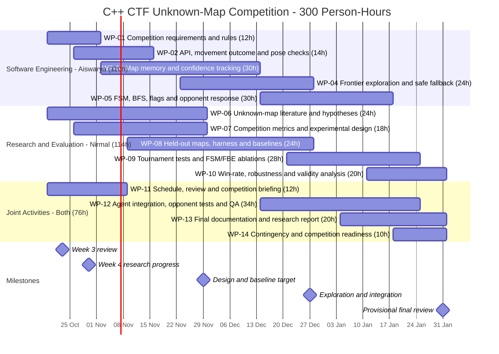

# Project Schedule — Unknown-Map Competition (Revised Week 4)

**Team:** Aiswarya Payakkal Vinayan and Nirmal Mohan  
**Planning period:** 19 October 2026–31 January 2027 (provisional)  
**Change:** WP descriptions updated for unseen-map competition; original dates, owners, 14 WP IDs and **300-hour total retained**.

## Effort summary

| Workstream | Planned person-hours |
|---|---:|
| Software Engineering — Aiswarya | 110 |
| Research and evaluation — Nirmal | 114 |
| Joint activities | 76 |
| **Total planned team effort** | **300** |

Joint work is budgeted equally: **Aiswarya 148 hours** and **Nirmal 152 hours** including their shared allocations. Planned time is not time already worked.

## Detailed work packages

| WP | Work package | Responsible | Start | End | Hours |
|---|---|---|---|---|---:|
| WP-01 | Competition requirements & rules | Aiswarya P. Vinayan | 19 Oct 2026 | 01 Nov 2026 | 12 |
| WP-02 | API, movement outcome & pose checks | Aiswarya P. Vinayan | 26 Oct 2026 | 15 Nov 2026 | 14 |
| WP-03 | Map memory & confidence tracking | Aiswarya P. Vinayan | 02 Nov 2026 | 13 Dec 2026 | 30 |
| WP-04 | Frontier exploration & safe fallback | Aiswarya P. Vinayan | 23 Nov 2026 | 27 Dec 2026 | 24 |
| WP-05 | FSM, BFS, flags & opponent response | Aiswarya P. Vinayan | 14 Dec 2026 | 17 Jan 2027 | 30 |
| WP-06 | Unknown-map literature & hypotheses | Nirmal Mohan | 19 Oct 2026 | 29 Nov 2026 | 24 |
| WP-07 | Competition metrics & experimental design | Nirmal Mohan | 26 Oct 2026 | 29 Nov 2026 | 18 |
| WP-08 | Held-out maps, harness & baselines | Nirmal Mohan | 09 Nov 2026 | 27 Dec 2026 | 24 |
| WP-09 | Tournament tests & FSM/FBE ablations | Nirmal Mohan | 21 Dec 2026 | 24 Jan 2027 | 28 |
| WP-10 | Win-rate, robustness & validity analysis | Nirmal Mohan | 11 Jan 2027 | 31 Jan 2027 | 20 |
| WP-11 | Schedule, review & competition briefing | Both (6 h each) | 19 Oct 2026 | 08 Nov 2026 | 12 |
| WP-12 | Agent integration, opponent tests & QA | Both (17 h each) | 14 Dec 2026 | 24 Jan 2027 | 34 |
| WP-13 | Final documentation & research report | Both (10 h each) | 04 Jan 2027 | 31 Jan 2027 | 20 |
| WP-14 | Contingency & competition readiness | Both (5 h each) | 18 Jan 2027 | 31 Jan 2027 | 10 |

## Planned work-package outputs

- **WP-01 — Competition requirements & rules:** Review objectives, host rules and competition-specific acceptance checks.
- **WP-02 — API, movement outcome & pose checks:** Validate DLL/API, movement failure detection and limits of relative position inference.
- **WP-03 — Map memory & confidence tracking:** Prototype local/persistent memory; represent uncertainty and reset on contradictions.
- **WP-04 — Frontier exploration & safe fallback:** Implement local novelty fallback and map-valid reachable frontier selection; use BFS routes in WP-05.
- **WP-05 — FSM, BFS, flags & opponent response:** Implement FSM state transitions, known-route BFS and only rule-verified flag/opponent responses; optional A* later.
- **WP-06 — Unknown-map literature & hypotheses:** Review exploration, real-time search, fair benchmarks and hypotheses; document actual reading depth.
- **WP-07 — Competition metrics & experimental design:** Define objective detection, reliability, movement, win-rate metrics and test controls.
- **WP-08 — Held-out maps, harness & baselines:** Build repeatable random/safe baselines on multiple maps; reserve unseen maps for evaluation.
- **WP-09 — Tournament tests & FSM/FBE ablations:** Test safe baseline, FBE-only, FBE+BFS and FBE+BFS+FSM versions if working, on held-out maps/opponents.
- **WP-10 — Win-rate, robustness & validity analysis:** Analyze win rate when observable, failures, uncertainty and between-map variation.
- **WP-11 — Schedule, review & competition briefing:** Update planning and prepare Week 4 research progress briefing; review feedback.
- **WP-12 — Agent integration, opponent tests & QA:** Integrate hybrid agent, perform host compatibility and opponent/robustness tests.
- **WP-13 — Final documentation & research report:** Reproduce source, test conditions, baseline comparisons and limitations.
- **WP-14 — Contingency & competition readiness:** Use buffer for critical defects, unknown map failures and final review.

## Dependencies and parallel research–software activities

- **WP-01/02:** Confirm requirements, host rules, DLL/API behavior and movement outcome assumptions.
- **WP-03:** Investigate reliable relative pose/memory, with uncertainty detection and recovery.
- **WP-04:** Build local safe exploration fallback and valid frontier selection. Persistent frontier targets require a spatially consistent map and verified pose.
- **WP-05:** Add BFS over known traversable cells and an FSM for explore/approach/pickup/return/deliver/respond/recover. All state transitions must use verified observations. A* is an optional optimization.
- **WP-06/07/08:** Research, measurement design and reference baseline tests proceed in parallel; reserve held-out map layouts for generalization assessment.
- **WP-09/10:** Compare tested ablations (safe, FBE, FBE+BFS, FBE+BFS+FSM) **only after each variant works**; compare **only implemented and tested** policies across repeated map and opponent conditions, then analyze failures, uncertainty and robustness.
- **WP-11–14:** Coordinate reviews, integration, reporting, contingency and competition readiness.

**Note:** WP-04 and WP-05 overlap with map-memory development intentionally; early local policies can be tested without claiming a reliable full map.

## Milestones (provisional)

| Milestone | Target | Planned review/output |
|---|---|---|
| Week 3 planning review | 23 Oct 2026 | Historical project definition and initial Gantt discussion |
| **Week 4 research progress** | **30 Oct 2026** | Literature findings, hybrid decision, software status, open questions |
| Design and baseline milestone | Nov 2026 | API verification, hypotheses, benchmark scenarios and map-state feasibility |
| Exploration/integration milestone | Dec 2026 | Validated exploration, route and opponent-response prototypes where feasible |
| Evaluation/report milestone | Jan 2027 | Held-out evaluations, validity analysis, report and final QA |

The official deadline and full competition rules still require confirmation.

## Delivery and tracking

- Continue iterative, incremental development with GitHub Issues and a short weekly review.
- Record individual contribution, decisions and actual tests in `devlog/developer-diary.md`.
- Include a reviewer in issue text or pull request. Update effort/dates only with an explicit team decision.
- Keep tested baseline agent versions separate from future hybrid-agent implementation.

## Gantt Chart (editable in Excel)

[Download/edit the Excel Gantt chart](Gantt_Chart.xlsx)

If the university GitHub renderer does not support Mermaid, the Excel chart is the authoritative editable visualization.

## Software and Research Roadmap Links

The Gantt is the calendar and effort view; the following two paths define the testable sequence and project hand-offs:

- [Software Development Roadmap](software-development-roadmap.md): safe fallback → movement checks → map/frontiers → BFS → FSM and verified game actions → integrated QA.
- [Research Roadmap](research-roadmap.md): literature/hypotheses → evaluation design → fair baselines → held-out map/opponent experiments → ablations → validity analysis.

The **14 work packages and 300 planned person-hours are unchanged**. **A*** has no mandatory work package and may be attempted only after core behaviors are reliable and the team reviews remaining effort.
